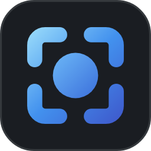
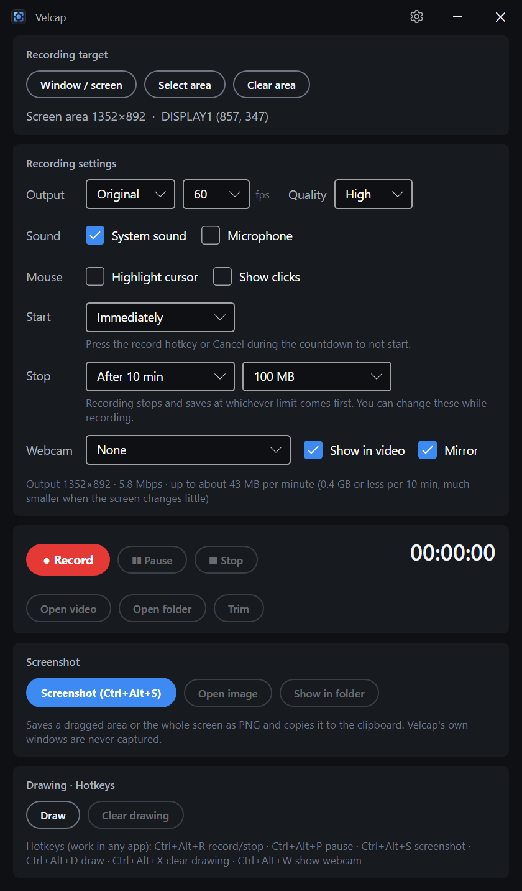
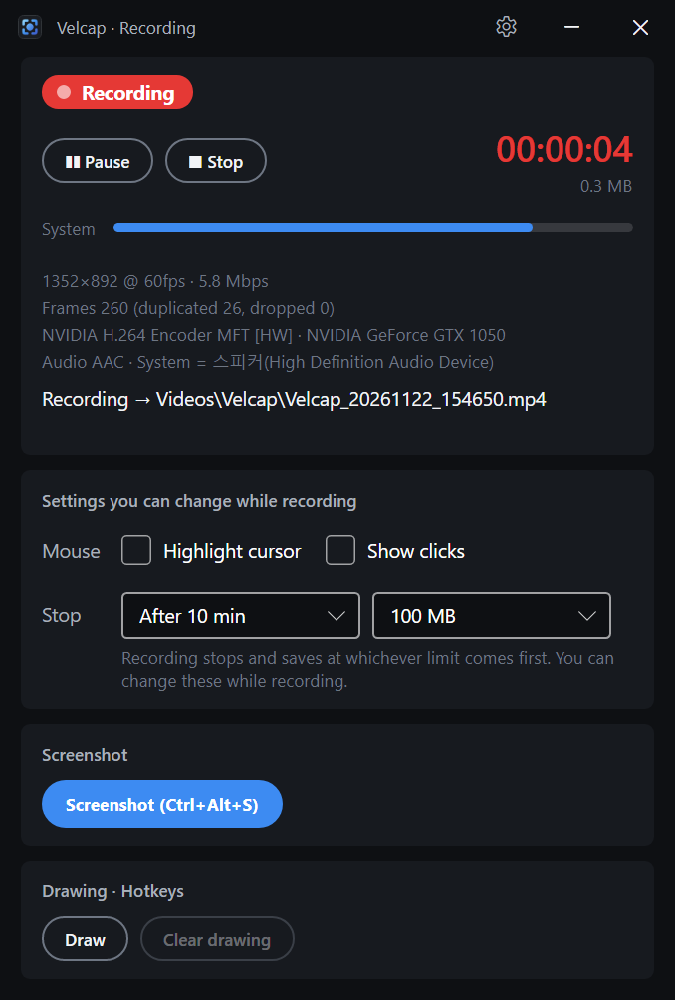
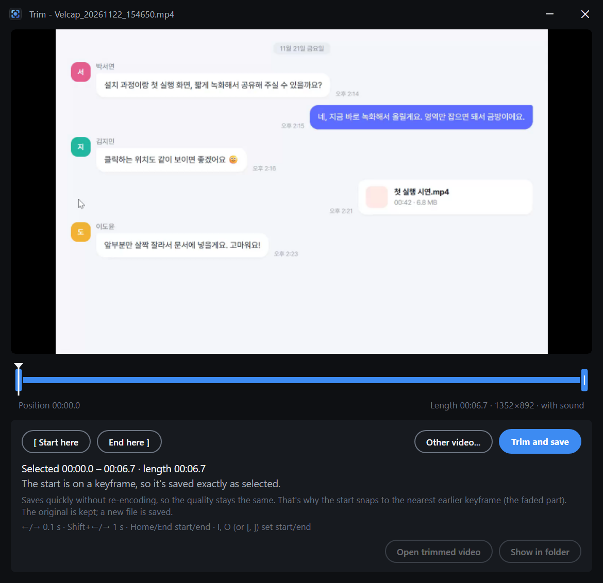

  

<h1 align="center">Velcap</h1>

A light, fast screen recorder for Windows that runs without installation

  <a href="README.md">한국어</a> · <b>English</b>

  <a href="https://github.com/vel-apps/velcap/releases/latest"><b>⬇ Download the latest version</b></a>

  
  &nbsp;
  

## Features

- **Smart area detection** — hover over the screen and Velcap highlights the window, a panel inside an app, or an area inside a web page. Click once to select it, and use the mouse wheel to step out to larger areas or back in.
- **Record a window, a monitor or any area** — choose resolution, frame rate and quality, and record system sound and your microphone together.
- **Countdown and auto-stop** — a 3, 2, 1 countdown before recording, and an automatic stop-and-save after a set length or file size.
- **Compact view while recording** — the window shrinks to what matters and shows the recording state at a glance.
- **Cursor highlight · click effects · on-screen drawing** — explain as you record with a pen, highlighter, rectangles and arrows.
- **Lossless trimming** — cut the start and end without re-encoding: same quality, saved in moments.
- **Screenshots** — save a selected area as PNG and copy it to the clipboard.
- **Webcam** — picture-in-picture, with background blur or removal.
- **Crash recovery** — if Velcap closes unexpectedly while recording, the recorded part is recovered on the next start.
- **Korean and English** — follows the Windows display language, or choose it in Settings.

  

## Install

1. Download `Velcap-<version>-win-x64.zip` from [Releases](https://github.com/vel-apps/velcap/releases/latest).
2. Unzip it anywhere you like (for example `D:\Apps\Velcap`).
3. Run `Velcap.exe`. Nothing else needs to be installed.

### If Windows shows "Windows protected your PC" on the first run

Click <b>[More info] → [Run anyway]</b>. Velcap is a new program that isn't code-signed yet, so Windows asks once.

## Requirements

- Windows 10 (version 2004 or later) or Windows 11, 64-bit
- A graphics card with hardware video encoding is recommended

## Tips

| Hotkey | Action |
|---|---|
| `Ctrl` + `Alt` + `R` | Start / stop recording (cancels during the countdown) |
| `Ctrl` + `Alt` + `P` | Pause / resume |
| `Ctrl` + `Alt` + `S` | Screenshot |
| `Ctrl` + `Alt` + `D` | Drawing on / off |
| `Ctrl` + `Alt` + `X` | Clear all drawings |
| `Ctrl` + `Alt` + `W` | Show / hide the webcam |

- Recordings and screenshots are saved to `Videos\Velcap` (changeable in Settings).
- Language: Settings → Language (Use Windows setting / 한국어 / English).
- Settings are stored in `%APPDATA%\Velcap`.
- Uninstall: delete the unzipped folder. To remove the settings too, delete `%APPDATA%\Velcap`.

## Feedback

Please open an [issue](https://github.com/vel-apps/velcap/issues).

## About using Velcap

Velcap is **distributed free of charge** so anyone can use it. Feel free to use it for personal or work purposes.

We built and tested it carefully, but we can't promise it will always work perfectly on every PC.
For important recordings, please do a short test first. We're sorry that we can't take responsibility for problems or data loss that may occur while using it.
Instead, please tell us about anything inconvenient in [Issues](https://github.com/vel-apps/velcap/issues) — it helps us make Velcap better.

## License

© 2026 SHOCAT

The open-source components included in Velcap and their licenses are listed in [THIRD-PARTY-NOTICES.txt](THIRD-PARTY-NOTICES.txt).
