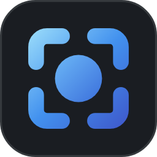
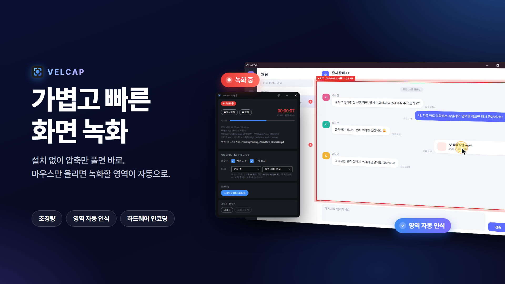
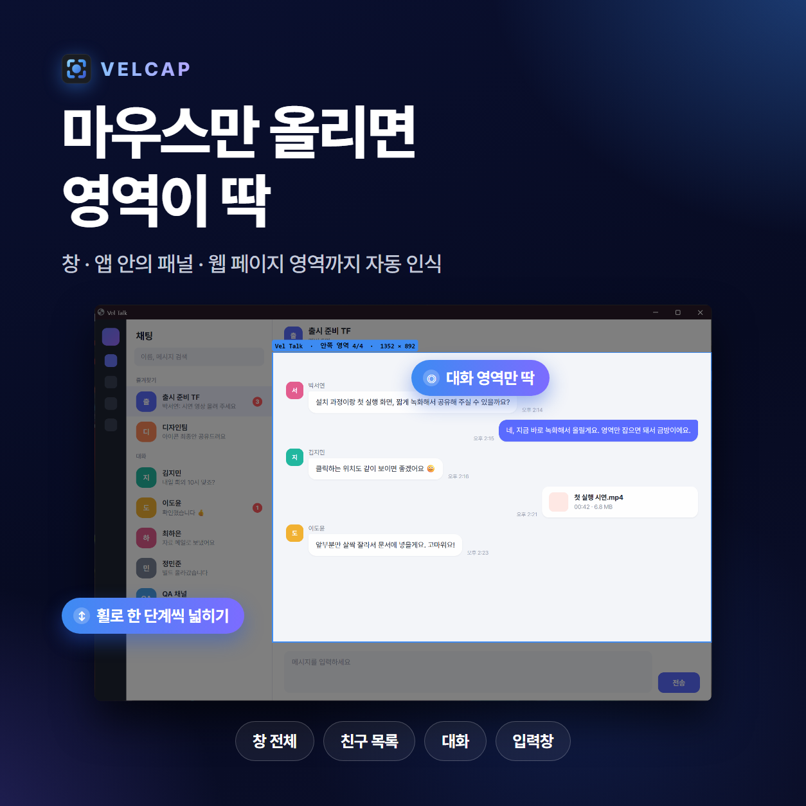
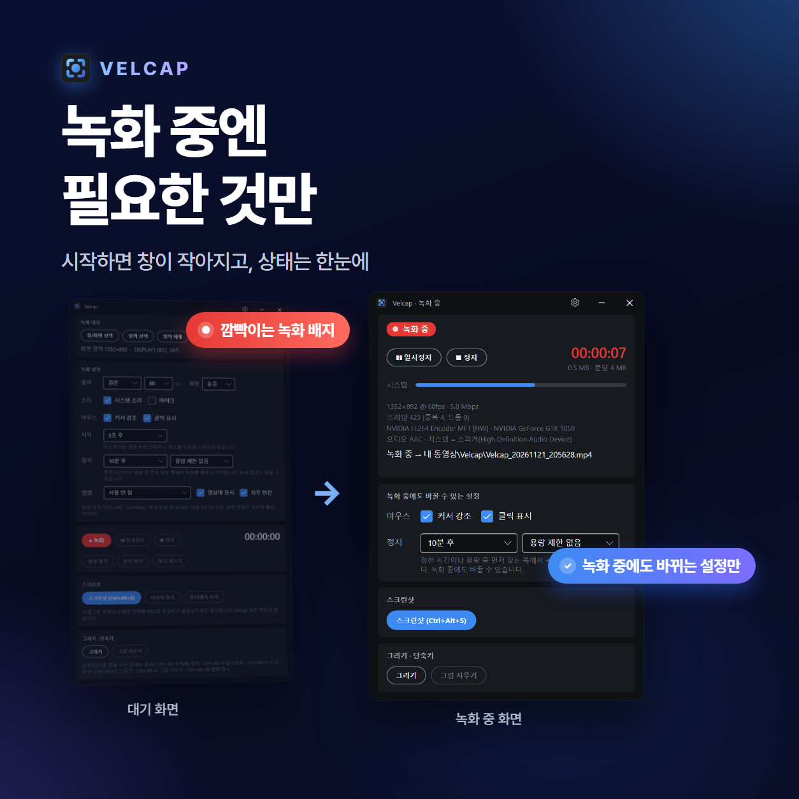
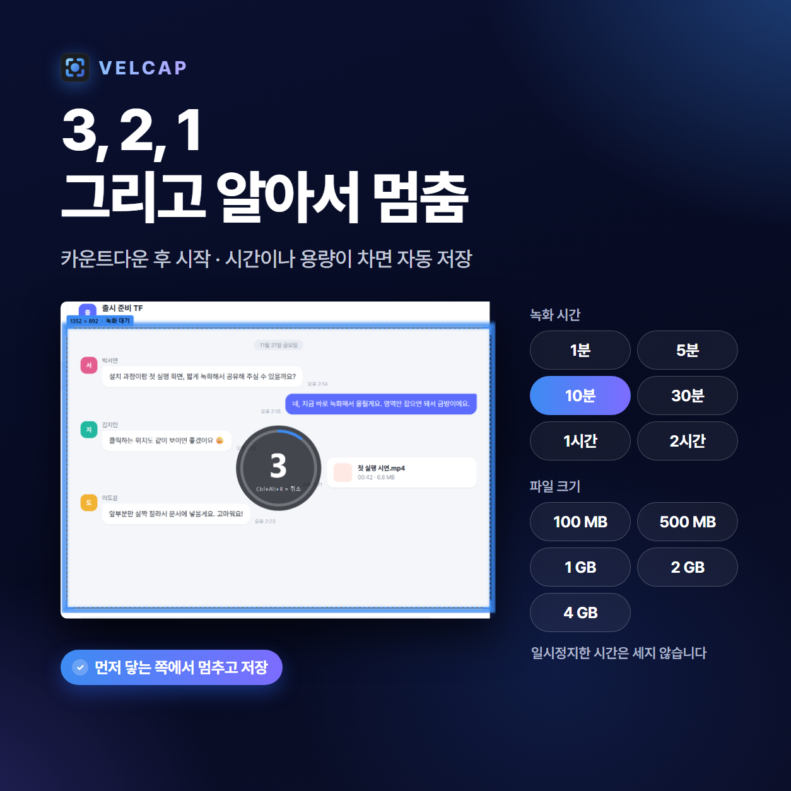
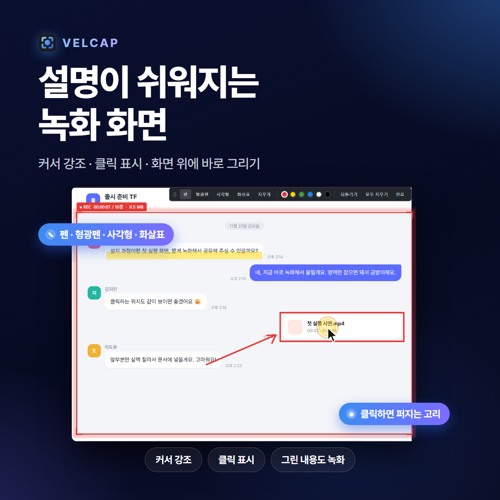
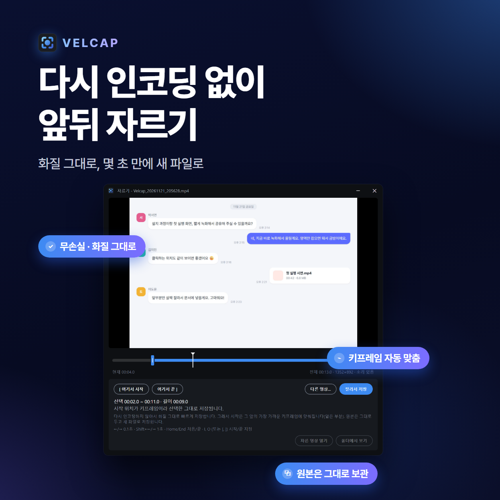
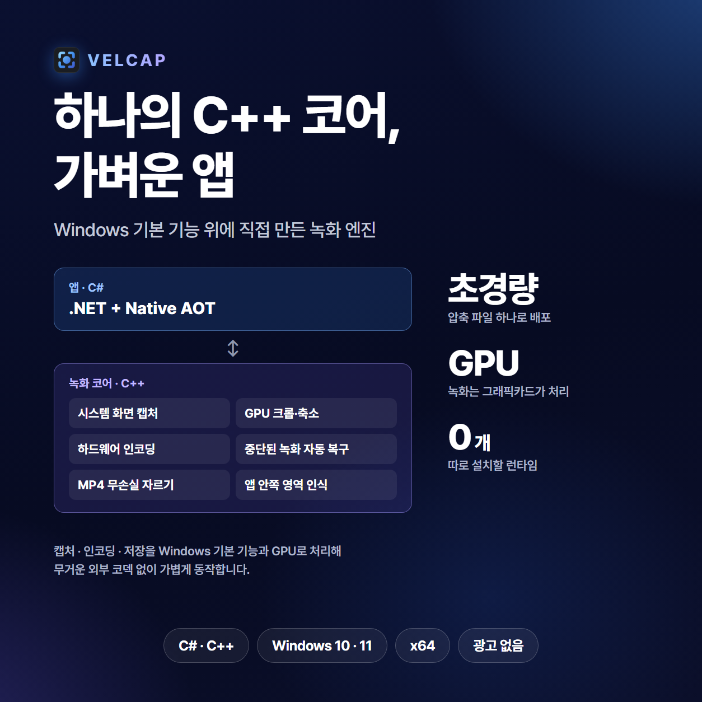

  

<h1 align="center">Velcap</h1>

설치 없이 바로 쓰는, 가볍고 빠른 Windows 화면 녹화 프로그램

  <b>한국어</b> · <a href="README.en.md">English</a>

  <a href="https://github.com/vel-apps/velcap/releases/latest"><b>⬇ 최신 버전 다운로드</b></a>

## 주요 기능

- **영역 자동 인식** — 마우스를 올리면 창, 앱 안의 패널, 웹 페이지 안 영역까지 자동으로 잡고, 클릭 한 번으로 선택합니다. 휠로 한 단계씩 넓히거나 좁힐 수 있습니다.
- **창 · 모니터 · 자유 영역 녹화** — 해상도·프레임·화질을 고르고, 시스템 소리와 마이크를 함께 녹음합니다.
- **카운트다운과 자동 정지** — 시작 전 3, 2, 1을 보여 주고, 정한 시간이나 파일 크기가 되면 알아서 멈추고 저장합니다.
- **녹화 중 작은 화면** — 녹화가 시작되면 창이 작아지고, 녹화 상태를 한눈에 보여 줍니다.
- **커서 강조 · 클릭 표시 · 화면 그리기** — 펜·형광펜·사각형·화살표로 녹화 중에 바로 설명할 수 있습니다.
- **무손실 앞뒤 자르기** — 다시 인코딩하지 않아 화질 그대로, 금방 새 파일로 저장합니다.
- **스크린샷** — 영역을 골라 PNG로 저장하고 클립보드에도 복사합니다.
- **웹캠** — 화면 속 화면으로 넣고, 배경을 흐리게 하거나 지울 수 있습니다.
- **녹화 자동 복구** — 녹화 중에 프로그램이 꺼져도 다음 실행 때 녹화된 부분을 되살립니다.
- **한국어 · 영어** — Windows 표시 언어를 따르고, 설정에서 직접 고를 수도 있습니다.

| | |
|---|---|
|  |  |
|  |  |
|  |  |

## 설치

1. [Releases](https://github.com/vel-apps/velcap/releases/latest)에서 `Velcap-<버전>-win-x64.zip`을 받습니다.
2. 원하는 곳(예: `D:\Apps\Velcap`)에 압축을 풉니다.
3. `Velcap.exe`를 실행합니다. 따로 설치할 프로그램은 없습니다.

### 처음 실행할 때 "Windows의 PC 보호" 창이 뜨면

<b>[추가 정보] → [실행]</b>을 누르세요. 아직 코드 서명이 되어 있지 않은 새 프로그램이라 Windows가 한 번 확인하는 것입니다.

## 시스템 요구사항

- Windows 10 (2004 이상) 또는 Windows 11, 64비트
- 하드웨어 인코딩을 지원하는 그래픽카드 권장

## 사용 팁

| 단축키 | 동작 |
|---|---|
| `Ctrl` + `Alt` + `R` | 녹화 시작 / 정지 (카운트다운 중에는 취소) |
| `Ctrl` + `Alt` + `P` | 일시정지 / 재개 |
| `Ctrl` + `Alt` + `S` | 스크린샷 |
| `Ctrl` + `Alt` + `D` | 그리기 켜기 / 끄기 |
| `Ctrl` + `Alt` + `X` | 그림 모두 지우기 |
| `Ctrl` + `Alt` + `W` | 웹캠 보이기 / 숨기기 |

- 녹화 파일과 스크린샷은 `내 동영상\Velcap`에 저장됩니다(설정에서 변경).
- 언어: 설정 → 언어 (Windows 설정 따름 / 한국어 / English)
- 설정은 `%APPDATA%\Velcap`에 저장됩니다.
- 제거: 압축을 푼 폴더를 지우면 됩니다. 설정까지 지우려면 `%APPDATA%\Velcap` 폴더도 지웁니다.

## 문제 신고 · 의견

[Issues](https://github.com/vel-apps/velcap/issues)에 남겨 주세요.

## 이용 안내

Velcap은 누구나 부담 없이 쓸 수 있도록 **무료로 배포**합니다. 개인·업무 용도 모두 자유롭게 사용하세요.

정성껏 만들고 여러 번 확인했지만, 모든 PC 환경에서 언제나 완벽하게 동작한다고 약속드리기는 어렵습니다.
중요한 녹화라면 미리 짧게 테스트해 보시길 권하며, 사용 중 생긴 문제나 데이터 손실에 대해서는 책임을 지기 어려운 점 너그럽게 양해해 주세요.
대신 불편한 점을 [Issues](https://github.com/vel-apps/velcap/issues)에 알려 주시면 더 나은 Velcap을 만드는 데 소중히 반영하겠습니다.

## 라이선스

© 2026 SHOCAT

Velcap에 포함된 오픈소스 구성 요소와 라이선스는 [THIRD-PARTY-NOTICES.txt](THIRD-PARTY-NOTICES.txt)에 있습니다.
